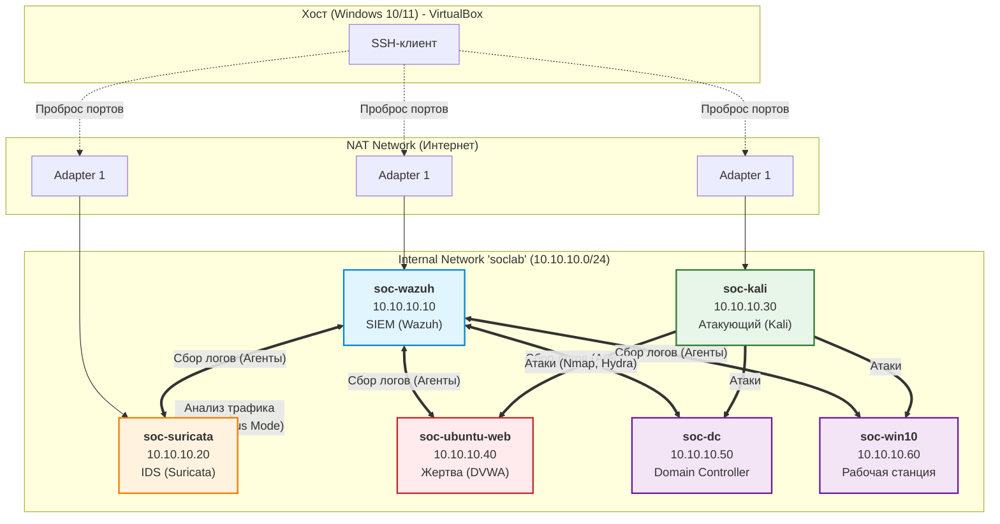

# 🛡️ Home SOC Lab


> Домашняя лаборатория для отработки полного цикла работы SOC-аналитика:
> **атака → детект → расследование → документирование → рекомендации**.

---

## 📑 Содержание

- [🎯 Цель проекта](#-цель-проекта)
- [🏗️ Архитектура](#️-архитектура)
- [🧰 Используемый стек](#-используемый-стек)
- [🔄 Методология](#-методология)
- [📋 Прогресс проекта](#-прогресс-проекта)
- [📁 Структура репозитория](#-структура-репозитория)
- [🚨 Отчёты об инцидентах](#-отчёты-об-инцидентах)
- [🚀 Как воспроизвести](#-как-воспроизвести)
- [📚 Чему я научился](#-чему-я-научился)
- [👤 Автор](#-автор)
- [📄 Лицензия](#-лицензия)

---

## 🎯 Цель проекта

Построить изолированный стенд, имитирующий корпоративную сеть небольшой компании, и на нём отработать навыки, которые требуются от **SOC Analyst L1/L2** и **Blue Team** специалиста:

- Централизованный сбор логов с гетерогенной инфраструктуры (Linux + Windows + AD)
- Написание и тюнинг правил корреляции в SIEM
- Детектирование сетевых атак через IDS
- Проведение расследований (triage, timeline, IOC extraction)
- Маппинг событий на **MITRE ATT&CK**
- Составление **Incident Report** по методологии **NIST SP 800-61**

Проект полностью воспроизводим: все конфиги, скрипты и настройки выложены в этом репозитории.

---

## 🏗️ Архитектура



**Компоненты стенда:**

| # | ВМ | Роль | ОС |
|---|----|------|-----|
| 1 | `soc-wazuh` | SIEM: сбор, корреляция, алертинг | Ubuntu Server 22.04 |
| 2 | `soc-suricata` | IDS: анализ сетевого трафика | Ubuntu Server 22.04 |
| 3 | `soc-kali` | Атакующий | Kali Linux |
| 4 | `soc-ubuntu-web` | Жертва: веб-сервер с DVWA | Ubuntu Server 22.04 |
| 5 | `soc-dc` | Domain Controller + AD | Windows Server 2022 |
| 6 | `soc-win10` | Рабочая станция в домене | Windows 10 |

Все ВМ находятся в изолированной сети **`10.10.10.0/24`** и не имеют доступа в интернет (кроме управления через NAT).

---

## 🧰 Используемый стек

| Компонент | Технология | Назначение |
|-----------|-----------|------------|
| Гипервизор | **VirtualBox** | Хостинг виртуальных машин |
| SIEM | **Wazuh** | Сбор логов, корреляция, алертинг, FIM |
| IDS | **Suricata** | Сигнатурный анализ трафика |
| Атакующий | **Kali Linux** | Симуляция атак (Nmap, Hydra, Metasploit, Burp) |
| Целевые ОС | **Ubuntu Server, Windows Server 2022, Windows 10** | Имитация реальной инфраструктуры |
| Уязвимое приложение | **DVWA** | Тренировка веб-атак |
| Маппинг | **MITRE ATT&CK** | Классификация техник атакующих |
| Методология | **NIST SP 800-61** | Оформление расследований |

---

## 🔄 Методология

Каждый этап проекта документируется по единой схеме:

1. **Задача** — что нужно сделать
2. **Действия** — как именно я это делал (с командами)
3. **Результат** — что получилось, скриншоты
4. **Выводы** — что я узнал, какие были проблемы

Отчёты об инцидентах оформляются по фазам **NIST SP 800-61**:

```
Detection → Analysis → Containment → Eradication → Recovery → Lessons Learned
```

Каждый инцидент маппится на технику из **MITRE ATT&CK** с указанием ID.

---

## 📋 Прогресс проекта

- [x] Этап 0: Определение цели и требований
- [x] Этап 1: Планирование архитектуры и создание репозитория
- [x] Этап 2: Установка и настройка гипервизора
- [x] Этап 3: Настройка изолированной сети
- [x] Этап 4: Развёртывание целевых машин
- [x] Этап 5: Установка и настройка Wazuh SIEM
- [x] Этап 6: Установка и настройка Suricata IDS
- [x] Этап 7: Интеграция компонентов
- [x] Этап 8: Развёртывание Windows-инфраструктуры (AD)
- [ ] Этап 9: Симуляция атак
- [ ] Этап 10: Расследование инцидентов и маппинг на MITRE ATT&CK
- [ ] Этап 11: Финальная документация и выводы

---

## 📁 Структура репозитория

```
home-soc-lab/
├── README.md
├── LICENSE
├── .gitignore
├── docs/
│   ├── 00-architecture.md       # Описание архитектуры стенда
│   ├── 01-hardware.md           # Требования к железу
│   ├── 02-network.md            # Схема сети и адресация
│   ├── setup/                   # Инструкции по развёртыванию
│   │   ├── 01-hypervisor.md
│   │   ├── 02-wazuh-vm-setup.md
│   │   ├── 03-ubuntu-web.md
│   │   ├── 04-wazuh-installation.md
│   │   └── 05-suricata-ids.md
│   ├── attacks/                 # Описание проведённых атак
│   │   ├── 01-ssh-bruteforce.md
│   │   ├── 02-port-scan.md
│   │   └── 03-web-attack.md
│   └── incidents/               # Отчёты об инцидентах
├── configs/
│   ├── wazuh/                   # Конфиги Wazuh Manager + агентов
│   ├── suricata/                # Правила и конфиг Suricata
│   └── virtualbox/              # Настройки сети и ВМ
├── scripts/                     # Скрипты автоматизации
├── diagrams/                    # Схемы сети и архитектуры
└── screenshots/                 # Скриншоты дашбордов и результатов
```

---

## 🚨 Отчёты об инцидентах

| ID | Инцидент | Техника MITRE ATT&CK | Отчёт |
|----|----------|----------------------|-------|
| INC-001 | *Будет добавлен после этапа 9* | — | — |
| INC-002 | — | — | — |
| INC-003 | — | — | — |

---

## 🚀 Как воспроизвести

Для воспроизведения лаборатории необходимо выполнить следующие шаги:

1. Установить VirtualBox и создать изолированную сеть soclab (Internal Network).
2. Развернуть soc-wazuh (Ubuntu Server) и установить Wazuh SIEM (All-in-One).
3. Развернуть soc-ubuntu-web (клон) и установить LAMP + уязвимое приложение DVWA.
4. Развернуть soc-suricata (клон) и настроить IDS в режиме Promiscuous Mode.
5. Подключить агенты Wazuh к целевым машинам.
6. Развернуть Windows Server (AD) и Windows 10, настроить логирование событий.
7. В планах: Симулировать атаки с soc-kali по сценариям из docs/attacks/.

---

## 📚 Чему я научился

*Раздел будет заполнен по окончании проекта. Планируемые темы:*

- Развёртывание и тюнинг Wazuh SIEM под корпоративную инфраструктуру
- Написание кастомных правил корреляции и снижение false positive
- Настройка Suricata в режиме IDS с зеркалированием трафика
- Работа с AD-логами и Windows Event Forwarding
- Проведение расследования по методологии NIST SP 800-61
- Маппинг событий на MITRE ATT&CK

---

## 👤 Автор

**Андрей** — начинающий специалист в области ИБ, цель: **SOC Analyst / Blue Team**

- 🐙 GitHub: [@ictfoxi](https://github.com/ictfoxi)
- 💼 Целевая роль: SOC Analyst L1
- 📍 Открыт к предложениям и стажировкам

---

## 📄 Лицензия

Проект распространяется под лицензией **MIT** — см. файл [LICENSE](LICENSE).