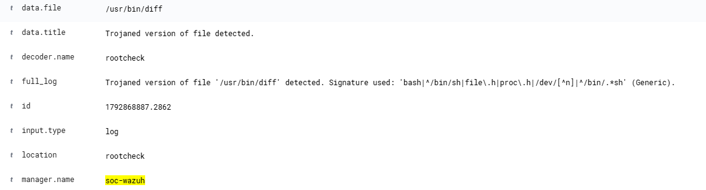

# INC-000: Ложное срабатывание Rootcheck на системную утилиту diff

## Описание инцидента
В SIEM Wazuh поступил алерт (Rule ID: 510, Level: 7) от агента `soc-ubuntu-web` о том, что файл `/usr/bin/diff` является "Trojaned version of file".


## Анализ (Triage)
1. Проверен путь: `/usr/bin/diff` — стандартная утилита Linux для сравнения файлов.
2. Проверена сигнатура: `'bash|^/bin/sh|file\.h|proc\.h...'` — слишком общая эвристическая сигнатура, используемая модулем Rootcheck.
3. Контекст: Файл не изменялся злоумышленником, является частью базового пакета Ubuntu (diffutils).

## Вердикт
**False Positive (Ложное срабатывание).** 

## Действия (Remediation / Tuning)
В конфигурационный файл агента `/var/ossec/etc/ossec.conf` в блок `<rootcheck>` добавлено исключение:
```xml
<ignore>/usr/bin/diff</ignore>