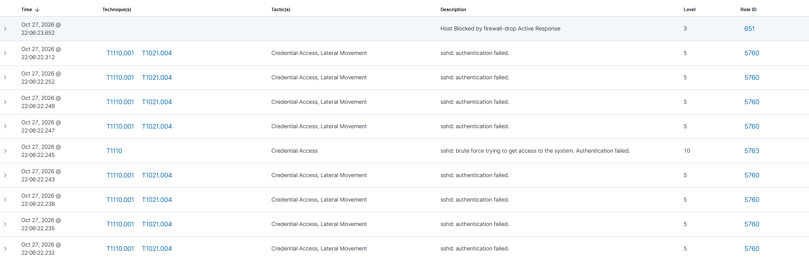

# INC-001: SSH Brute Force на веб-сервер

## 1. Метаданные
- **ID инцидента:** INC-001
- **Дата:** 27.10.2026
- **Критичность:** High
- **Техника MITRE ATT&CK:** T1110.001 (Brute Force: Password Guessing)
- **Затронутый хост:** `soc-ubuntu-web` (10.10.10.40)
- **Источник атаки:** `soc-kali` (10.10.10.30)

## 2. Обнаружение (Detection)
Система Wazuh SIEM зафиксировала множественные неудачные попытки входа по SSH (Rule ID: 5763). Suricata IDS также зафиксировала аномальную сетевую активность. 
Инструмент атаки: `Hydra`.

## 3. Анализ (Analysis)
В ходе триажа установлено, что IP-адрес `10.10.10.30` осуществлял подбор паролей к учетной записи `socadmin` по протоколу SSH (порт 22). Количество попыток превысило порог срабатывания правила.

## 4. Сдерживание (Containment)
На сервере `soc-ubuntu-web` автоматически сработал механизм **Wazuh Active Response** (команда `firewall-drop`). IP-адрес атакующего был заблокирован в `iptables` на 600 секунд (10 минут).

## 5. Устранение и Восстановление (Eradication & Recovery)
Блокировка была снята автоматически по истечении таймаута. Пароль пользователя `socadmin` не был скомпрометирован (является сложным). Дополнительных действий не требуется.

## 6. Выводы (Lessons Learned)
- Механизм автоматической блокировки (Active Response) работает корректно.
- Рекомендуется внедрить `fail2ban` как дополнительный уровень защиты и настроить аутентификацию по SSH-ключам (отключить вход по паролю).