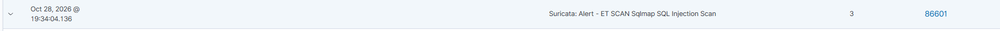

# INC-002: Сканирование уязвимостей и попытка SQL-инъекции на веб-сервер

## 1. Метаданные
- **ID инцидента:** INC-002
- **Дата:** 28.10.2026
- **Критичность:** Medium
- **Техники MITRE ATT&CK:** T1595 (Active Scanning), T1190 (Exploit Public-Facing Application)
- **Затронутый хост:** `soc-ubuntu-web` (10.10.10.40)
- **Источник атаки:** `soc-kali` (10.10.10.30)

## 2. Обнаружение (Detection)
Система Suricata IDS (агент `soc-suricata`) зафиксировала сетевой трафик, характерный для сканирования веб-приложений и попытки SQL-инъекции.
Сработало правило: **`ET SCAN Sqlmap SQL Injection Scan`**. 
Wazuh SIEM получил этот JSON-лог и отобразил его в дашборде (Rule ID: 86601).

## 3. Анализ (Analysis)
Анализ сетевых пакетов и логов веб-сервера показал, что с IP-адреса `10.10.10.30` были отправлены HTTP-запросы с подозрительным User-Agent (имитация `sqlmap`) и полезной нагрузкой в параметрах URL (`id=1' OR 1=1--`). 
Целью атаки было выявление уязвимости SQL-инъекции в приложении DVWA.

## 4. Сдерживание (Containment)
Атака была пассивно залогирована IDS (режим IDS, а не IPS). Веб-приложение DVWA является намеренно уязвимым, поэтому запросы не были заблокированы на сетевом уровне. 

## 5. Устранение и Восстановление (Eradication & Recovery)
В рамках данной лабораторной работы эксплуатация уязвимости была частью учебного процесса. В реальной среде потребовалось бы обновление веб-приложения, использование параметризованных запросов и настройка WAF.

## 6. Выводы (Lessons Learned)
- Suricata успешно детектирует веб-сканеры и попытки эксплуатации на основе сигнатур.