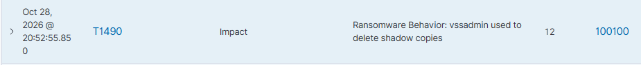

# INC-003: Подозрительная активность и детектирование Ransomware на Windows 10

## 1. Метаданные (Metadata)
- **ID инцидента:** INC-003
- **Дата:** 28 октября 2026 г.
- **Критичность:** High (Высокая)
- **Статус:** Closed (Закрыт)
- **Затронутый хост:** `soc-win10` (IP: 10.10.10.60)
- **Источник атаки:** Имитация локального запуска (Red Team Simulation)
- **Техники MITRE ATT&CK:** 
  - `T1490` (Inhibit System Recovery)
  - `T1059` (Command and Scripting Interpreter)
  - `T1033` (System Owner/User Discovery)

## 2. Обнаружение (Detection)
В ходе симуляции действий злоумышленника на рабочей станции `soc-win10` были выполнены команды, имитирующие действия вредоносного ПО. 

SIEM-система Wazuh (на базе логов Sysmon) зафиксировала следующие события:
1. **Запуск разведывательных команд:** Выполнение `whoami /priv` и `systeminfo` через PowerShell (зафиксировано в архивах Wazuh, Event ID 1).
2. **Критический алерт:** Выполнение команды `vssadmin.exe delete shadows /all /quiet`. 
   - **Rule ID:** 100100 (Кастомное правило)
   - **Level:** 12 (High)
   - **Описание:** Ransomware Behavior: vssadmin used to delete shadow copies.

## 3. Анализ и Триаж (Analysis & Triage)
В процессе мониторинга дашборда были проанализированы два типа событий:

**А) Ложное срабатывание (False Positive):**
Изначально система выдала алерт критического уровня (Level 15, Rule ID 92213) на создание файла `well_known_domains.dll` в папке `C:\Users\jdoe\AppData\Local\Temp\`. 
*Триаж:* Анализ показал, что процесс-инициатор — `msedge.exe` (браузер Microsoft Edge). Это легитимное поведение браузера при обновлении компонентов. Алерт помечен как False Positive.

**Б) Реальная угроза (True Positive):**
Запуск утилиты `vssadmin.exe` для удаления теневых копий. Злоумышленники (и шифровальщики) используют этот метод (T1490), чтобы жертва не смогла восстановить свои файлы из резервных копий после атаки.
*Действие аналитика:* Так как базовое правило Sysmon (61603) не генерировало алерт на это событие, в конфигурацию Wazuh Manager (`/var/ossec/etc/rules/local_rules.xml`) было добавлено кастомное правило **100100** с уровнем критичности 12.

## 4. Сдерживание (Containment)
В условиях изолированной лаборатории активных действий по блокировке не требовалось. 
В реальной корпоративной среде (Production) при срабатывании правила 100100 были бы выполнены следующие шаги:
- Изоляция хоста `soc-win10` от сети (Network Isolation через EDR или VLAN).
- Блокировка учетной записи пользователя `SOCLAB\jdoe`.
- Запуск процедуры антивирусного сканирования.

## 5. Устранение и Восстановление (Eradication & Recovery)
- Проверено отсутствие реального шифрования файлов (команда `vssadmin` была лишь симуляцией).
- Теневые копии не были критически важны для работы тестового стенда.
- В случае реальной атаки потребовалось бы восстановление из оффлайн-бэкапов и переустановка ОС.

## 6. Выводы и Рекомендации (Lessons Learned)
1. **Настройка правил (Tuning):** Базовые правила Wazuh не всегда генерируют алерты на действия злоумышленников. Навык написания кастомных правил (Custom Rules) с привязкой к MITRE ATT&CK является критически важным для SOC-аналитика.
2. **Глубина логирования:** Использование Sysmon с конфигурацией SwiftOnSecurity позволяет видеть полные командные строки (Command Line) и сетевые подключения процессов, что невозможно при использовании только встроенного аудита Windows.