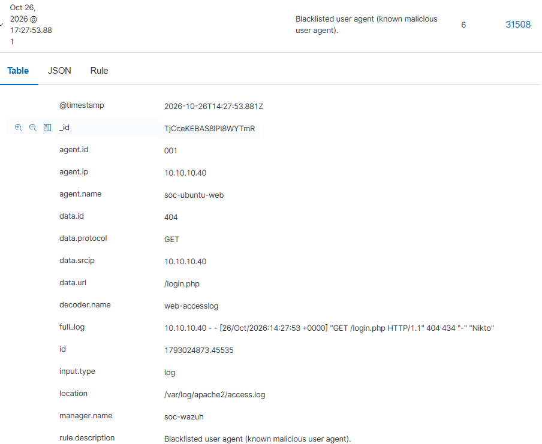
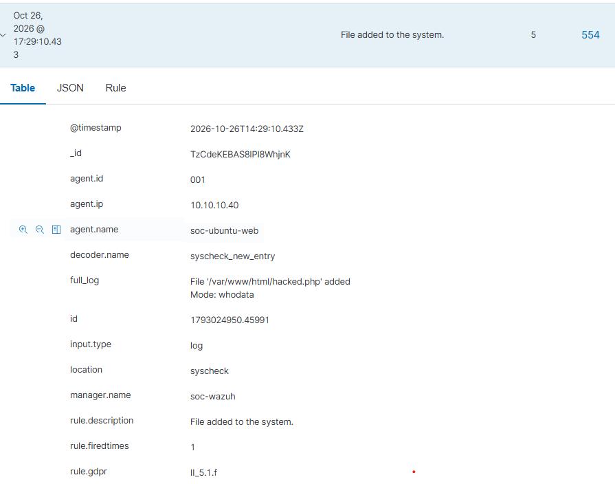

# Этап 8.3. Расширенный мониторинг веб-сервера (soc-ubuntu-web)

## Задача
Настроить Wazuh Agent на сбор логов веб-сервера Apache и мониторинг целостности файлов веб-приложения (DVWA) для детектирования веб-атак и загрузки веб-шеллов.

## Действия

### 1. Сбор логов Apache
В конфигурацию агента `/var/ossec/etc/ossec.conf` добавлены директивы:
```xml
<localfile>
  <log_format>apache</log_format>
  <location>/var/log/apache2/access.log</location>
</localfile>
<localfile>
  <log_format>apache</log_format>
  <location>/var/log/apache2/error.log</location>
</localfile>

### 2. Мониторинг целостности файлов (FIM)
В блок <syscheck> добавлена директория /var/www/html с параметрами:

- check_all="yes" (проверять хэши, права, владельца)
- report_changes="yes" (показывать diff-изменения)
- whodata="yes" (отслеживать, какой процесс изменил файл)

## Результат
Wazuh фиксирует все HTTP-запросы к DVWA (включая User-Agent атакующих).

Любые изменения в файлах сайта (например, загрузка веб-шелла) генерируют алерт с указанием пользователя и процесса.
