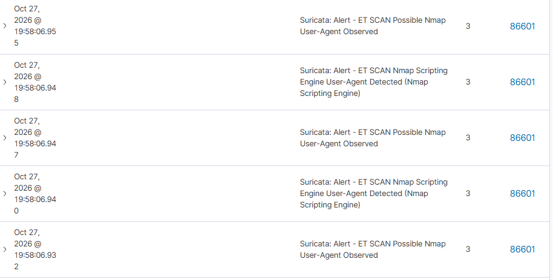

# Этап 10. Развёртывание Kali Linux (Атакующий)

## Задача
Развернуть ВМ с Kali Linux для имитации действий злоумышленника (Red Team) и проверки настроек детектирования SIEM.

## Параметры ВМ
| Параметр | Значение |
| :--- | :--- |
| Имя ВМ | `soc-kali` |
| IP (internal) | `10.10.10.30/24` |
| ОС | Kali Linux (готовый образ VirtualBox) |

## Действия
1. Импортирован готовый образ Kali Linux.
2. Настроена сеть: Adapter 1 (NAT), Adapter 2 (Internal Network `soclab`).
3. Настроен статический IP `10.10.10.30/24` через NetworkManager.
4. Проверена сетевая связность с целевыми машинами (`ping 10.10.10.40`, `ping 10.10.10.50`).
5. Проведен первичный скан уязвимостей (`nmap -sV -p 80,22 10.10.10.40`).
6. Подтверждено срабатывание IDS Suricata и отображение алертов в Wazuh.

## Результат
- Атакующая инфраструктура готова.
- Система детектирования успешно фиксирует сетевые сканирования.
